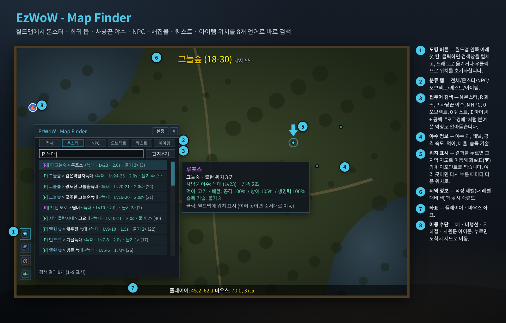
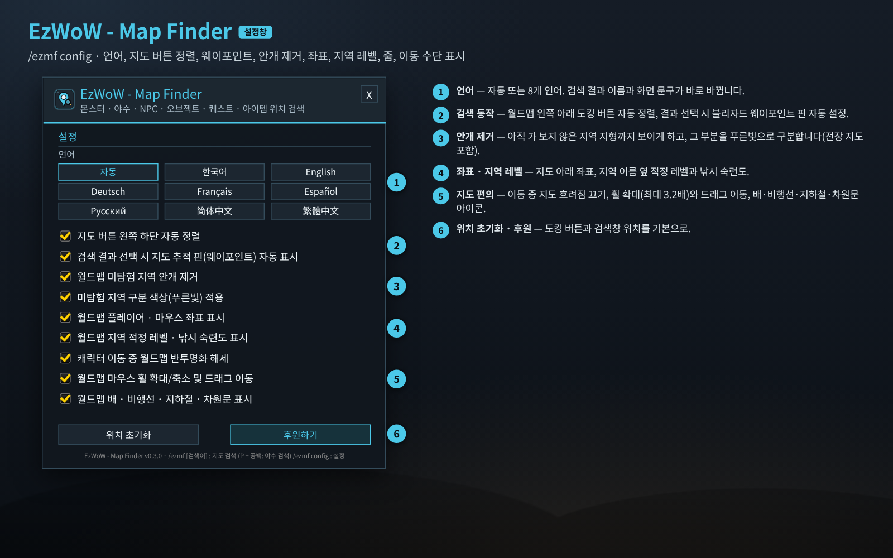
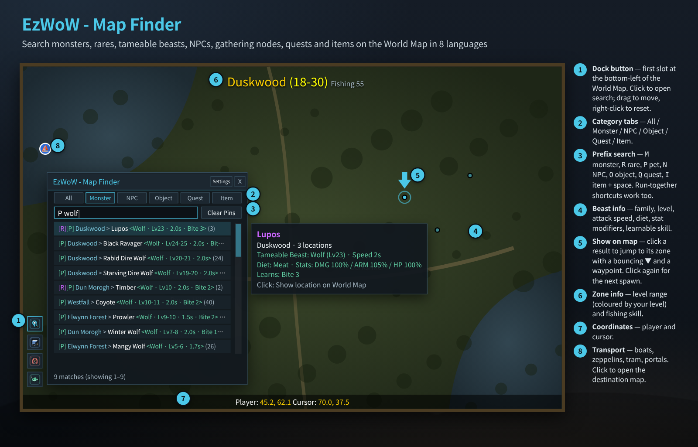
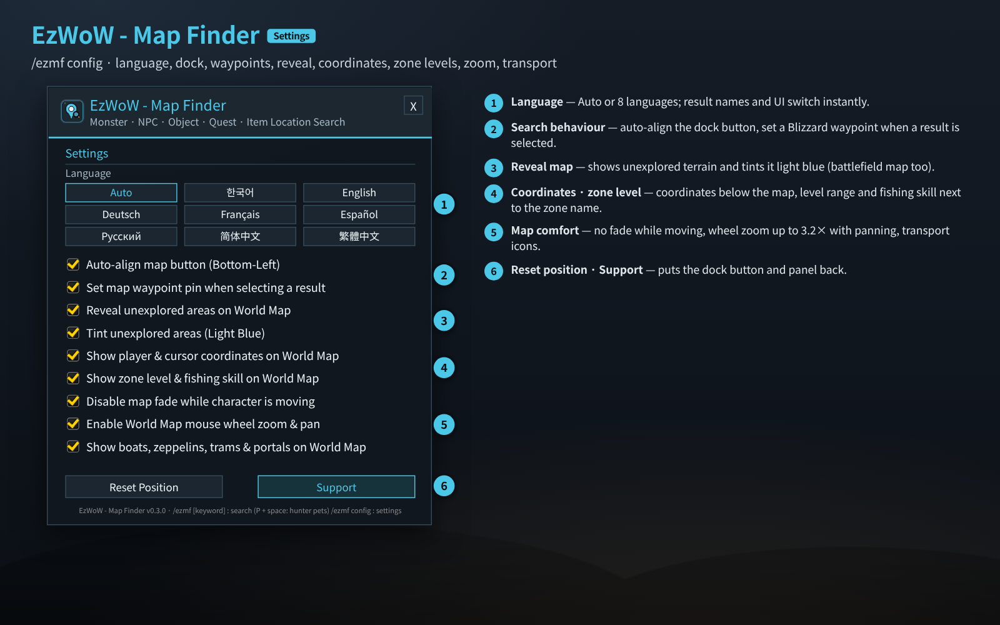

# EzWoW - Map Finder (`EzWoW-MapFinder`)

## CurseForge

- **Project ID / 프로젝트 ID:** `1755566`
- **Project page / 프로젝트 페이지:** [EzWoW-MapFinder](https://www.curseforge.com/wow/addons/ezwow-map-finder)

**[한국어](#한국어) · [English](#english)**

WoW Forever (`Interface: 16001`) · `v0.3.0` · `/ezmf`

---

## 한국어

### 개요

월드맵에서 **몬스터 · 희귀 몬스터 · 사냥꾼이 길들일 수 있는 야수 · NPC · 채집물/오브젝트 · 퀘스트 · 아이템** 위치를 바로 찾아 주는 오프라인 검색 애드온입니다. 내장 데이터는 **20,930개 항목**(NPC 7,421 · 오브젝트 7,656 · 퀘스트 4,140 · 아이템 1,713)이며 8개 언어 이름으로 검색할 수 있습니다. 미탐험 지역 안개 제거, 좌표, 지역 적정 레벨, 휠 확대, 배·비행선·지하철·차원문 표시 같은 월드맵 편의 기능도 들어 있습니다.

### 화면 미리보기

> 이미지는 애드온 코드의 창 크기·좌표·색상·문구와 내장 데이터(야수 이름·레벨·기술)로 재현한 **예시 화면**입니다. 실제로는 게임 월드맵 위에 나타납니다.

### 설치

1. `EzWoW-MapFinder` 폴더를 `Interface/AddOns/` 폴더에 넣습니다.
2. 캐릭터 선택 화면의 **애드온** 목록에서 켭니다.
3. 월드맵(`M`)을 열고 왼쪽 아래 **첫 번째 도킹 버튼**을 누르거나, `/ezmf 검색어`를 입력합니다.

### 사용법 (위 그림의 번호)

| 번호 | 부분 | 설명 |
|---|---|---|
| ① | 도킹 버튼 | 월드맵 왼쪽 아래 첫 칸. 좌클릭: 검색창 펼치기/접기 · 드래그: 위치 이동 · 우클릭: 위치 초기화 |
| ② | 분류 탭 | 전체 / 몬스터 / NPC / 오브젝트 / 퀘스트 / 아이템 |
| ③ | 검색창 | 이름 일부를 입력합니다. **접두어 + 공백**으로 종류를 좁힐 수 있습니다(아래 표). “오그경매”, “스톰은행”, “아포은행”, “가젯여관”, “기공”, “마부”, “수리”, “날탈”처럼 붙여 쓴 약칭도 알아듣습니다. **핀 지우기**는 지도에 찍은 표시를 지웁니다. |
| ④ | 야수 정보 | `P `로 찾으면 야수 과, 레벨, 공격 속도, 먹이, 공격/방어/생명력 배율, 배울 수 있는 기술(단계)이 결과와 툴팁에 나옵니다. |
| ⑤ | 위치 표시 | 결과를 누르면 그 지역 지도로 이동해 **튀는 화살표(▼)**와 게임 기본 **웨이포인트 핀**을 찍습니다. 출현 지점이 여러 곳이면 누를 때마다 다음 위치로 넘어갑니다. |
| ⑥ | 지역 정보 | 지역 이름 옆에 적정 레벨(내 레벨 대비 색)과 필요한 낚시 숙련도 |
| ⑦ | 좌표 | 지도 아래에 플레이어 · 마우스 좌표 |
| ⑧ | 이동 수단 | 배 · 비행선 · 깊은굴 지하철 · 차원문(제프라스 섬 · 강물숲 · 달라란 포함)을 진영 색 아이콘으로 표시하고, 누르면 도착지 지도로 이동합니다. |

#### 접두어 검색

| 입력 | 찾는 대상 | 결과 배지 |
|---|---|---|
| `M 이름` | 일반 몬스터 | `[M]` |
| `R 이름` | 은테 희귀 몬스터 | `[R]` |
| `P 이름` | 사냥꾼이 길들일 수 있는 야수 (`P 늑대`, `P 할퀴기`, `P 물기 6`, `P 1.2` 등) | `[P]` |
| `N 이름` | 우호 NPC · 상인 · 교관 | `[N]` |
| `O 이름` | 약초 · 광맥 · 상자 등 오브젝트 (채집에 필요한 숙련도 함께 표시) | `[O]` |
| `Q 이름` | 퀘스트 | `[Q]` |
| `I 이름` | 아이템 | `[I]` |

- 다른 EzWoW 애드온과 연동됩니다: `EzWoW-BestGearFinder`(아이템 우클릭), `EzWoW-ProfessionRecipes`(제조법/재료 우클릭), `EzWoW-DungeonRouteGuide`(던전 퀘스트 우클릭)에서 이 애드온으로 위치를 검색합니다.
- 포에버 신규 지역(하이잘 산, 제프라스 섬, 강물숲)도 지원합니다.

### 설정창 (`/ezmf config`)

| 번호 | 항목 | 기본값 |
|---|---|---|
| ① | 언어: 자동 / 한국어 / English / Deutsch / Français / Español / Русский / 简体中文 / 繁體中文 | 자동 |
| ② | 지도 버튼 왼쪽 하단 자동 정렬 | 켬 |
| ② | 검색 결과 선택 시 지도 추적 핀(웨이포인트) 자동 표시 | 켬 |
| ③ | 월드맵 미탐험 지역 안개 제거 (전장 지도 `Shift+M` 포함) | 켬 |
| ③ | 미탐험 지역 구분 색상(푸른빛) 적용 | 켬 |
| ④ | 월드맵 플레이어 · 마우스 좌표 표시 | 켬 |
| ④ | 월드맵 지역 적정 레벨 · 낚시 숙련도 표시 | 켬 |
| ⑤ | 캐릭터 이동 중 월드맵 반투명화 해제 | 켬 |
| ⑤ | 월드맵 마우스 휠 확대/축소(최대 3.2배) 및 드래그 이동 | 켬 |
| ⑤ | 월드맵 배 · 비행선 · 지하철 · 차원문 표시 | 켬 |
| ⑥ | 위치 초기화 · 후원하기 | - |

### 명령어 (`/ezmf`, `/emf`, `/맵파인더`)

| 명령어 | 설명 |
|---|---|
| `/ezmf 검색어` | 월드맵 검색창을 열고 바로 검색 (`P 늑대`처럼 접두어 사용 가능) |
| `/ezmf config` (`설정`) | 설정창 |
| `/ezmf clear` | 지도에 찍은 검색 핀과 웨이포인트 지우기 |
| `/ezmf lang <auto\|ko\|en\|de\|fr\|es\|ru\|cn\|tw>` | 표시 언어 변경 |
| `/ezmf help` | 도움말 |

### 저장 데이터

- `EzWoW_MapFinderDB`: 설정, 도킹 버튼 위치.

### 알아두면 좋은 점

- 전투 중에는 게임 규칙상 지도 지역을 바꿀 수 없습니다. 전투가 끝난 뒤 결과를 눌러 주세요.
- 검색은 프레임이 끊기지 않도록 나눠서 진행되며, 진행 중에는 `[검색중...] (%)`이 보입니다.

---

## English

### Overview

Map Finder is an offline location search for the World Map: **monsters, rare elites, tameable beasts, NPCs, gathering nodes/objects, quests and items**. The built-in data has **20,930 entries** (7,421 NPCs · 7,656 objects · 4,140 quests · 1,713 items) searchable by name in 8 languages. It also adds World Map conveniences: reveal unexplored areas, coordinates, zone level ranges, wheel zoom and boat/zeppelin/tram/portal icons.

### Screenshots

> These are **mock-ups** rebuilt from the window sizes, coordinates, colours and strings in the code and the bundled data (beast names, levels and skills). In game it appears on the World Map.

### Installation

1. Copy the `EzWoW-MapFinder` folder into `Interface/AddOns/`.
2. Enable it in the **AddOns** list on the character select screen.
3. Open the World Map (`M`) and click the **first dock button** at the bottom-left, or type `/ezmf keyword`.

### How to use (numbers in the picture)

| No. | Part | Description |
|---|---|---|
| ① | Dock button | First slot at the bottom-left of the World Map. Left-click: open/close search · drag: move · right-click: reset position |
| ② | Category tabs | All / Monster / NPC / Object / Quest / Item |
| ③ | Search box | Type part of a name. A **prefix + space** narrows the type (table below). Run-together Korean shortcuts (e.g. “오그경매” = Orgrimmar auction house) are understood. **Clear Pins** removes the map markers. |
| ④ | Beast info | With `P ` you get family, level, attack speed, diet, damage/armor/health modifiers and learnable skills (rank) in the results and tooltip. |
| ⑤ | Show on map | Click a result to jump to its zone with a **bouncing arrow (▼)** and a Blizzard **waypoint pin**. With several spawns, each click moves to the next one. |
| ⑥ | Zone info | Level range (coloured against your level) and required fishing skill next to the zone name |
| ⑦ | Coordinates | Player and cursor coordinates below the map |
| ⑧ | Transport | Boats, zeppelins, the Deeprun Tram and portals (incl. Zephras Isle, Riverglades and Dalaran) in faction colours; click to open the destination map. |

#### Prefix search

| Input | Finds | Badge |
|---|---|---|
| `M name` | Normal monsters | `[M]` |
| `R name` | Rare elites | `[R]` |
| `P name` | Tameable beasts (`P wolf`, `P claw`, `P bite 6`, `P 1.2` …) | `[P]` |
| `N name` | Friendly NPCs, vendors, trainers | `[N]` |
| `O name` | Herbs, ore, chests and other objects (with required gathering skill) | `[O]` |
| `Q name` | Quests | `[Q]` |
| `I name` | Items | `[I]` |

- Works with other EzWoW addons: `EzWoW-BestGearFinder` (right-click an item), `EzWoW-ProfessionRecipes` (right-click a recipe/reagent) and `EzWoW-DungeonRouteGuide` (right-click a dungeon quest) search through Map Finder.
- New Forever zones (Mount Hyjal, Zephras Isle, Riverglades) are supported.

### Settings window (`/ezmf config`)

| No. | Option | Default |
|---|---|---|
| ① | Language: Auto / 한국어 / English / Deutsch / Français / Español / Русский / 简体中文 / 繁體中文 | Auto |
| ② | Auto-align map button (Bottom-Left) | On |
| ② | Set map waypoint pin when selecting a result | On |
| ③ | Reveal unexplored areas on World Map (battlefield map `Shift+M` too) | On |
| ③ | Tint unexplored areas (Light Blue) | On |
| ④ | Show player & cursor coordinates on World Map | On |
| ④ | Show zone level & fishing skill on World Map | On |
| ⑤ | Disable map fade while character is moving | On |
| ⑤ | Enable World Map mouse wheel zoom (up to 3.2×) & pan | On |
| ⑤ | Show boats, zeppelins, trams & portals on World Map | On |
| ⑥ | Reset Position · Support | - |

### Slash commands (`/ezmf`, `/emf`, `/맵파인더`)

| Command | Description |
|---|---|
| `/ezmf keyword` | Open the search panel and search (prefixes like `P wolf` work) |
| `/ezmf config` | Settings |
| `/ezmf clear` | Clear search pins and the waypoint |
| `/ezmf lang <auto\|ko\|en\|de\|fr\|es\|ru\|cn\|tw>` | Change display language |
| `/ezmf help` | Help |

### Saved data

- `EzWoW_MapFinderDB`: settings and dock button position.

### Tips

- The game does not allow changing the map zone in combat; click the result again after combat.
- Searches run in small steps to avoid frame drops; `[Searching...] (%)` is shown meanwhile.

---

## Support / 후원

If you find this addon useful, you can support its development.

애드온이 도움이 되셨다면 개발 후원으로 응원해 주세요.

[Buy Me a Coffee ☕](https://buymeacoffee.com/qqhrqqhr2)
