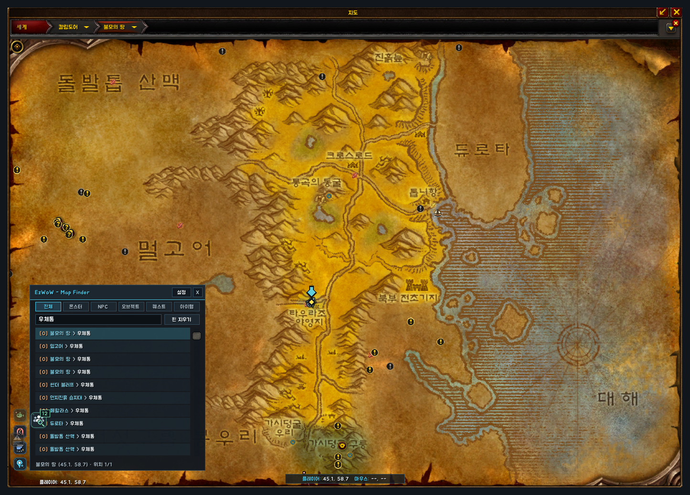
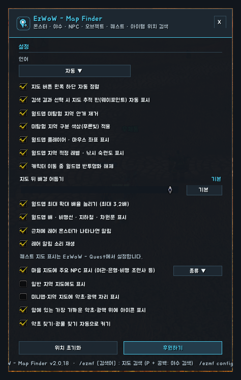
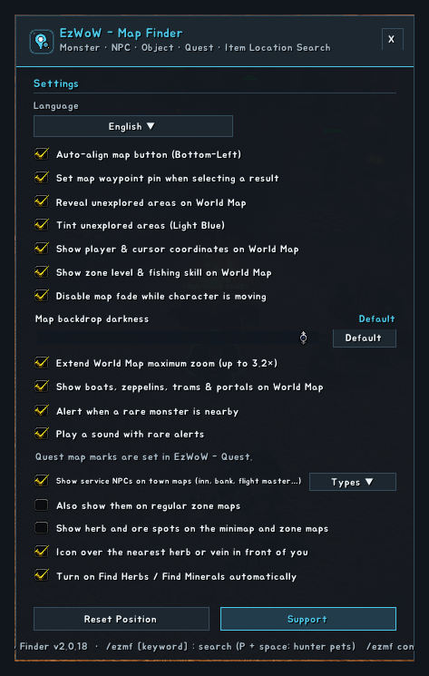

# EzWoW - Map Finder (`EzWoW-MapFinder`)

## CurseForge

- **Project ID / 프로젝트 ID:** `1755566`
- **Project page / 프로젝트 페이지:** [EzWoW-MapFinder](https://www.curseforge.com/wow/addons/ezwow-map-finder)

**[한국어](#한국어) · [English](#english)**

WoW Forever (`Interface: 16001`) · `/ezmf`

---

## 한국어

### 개요

월드맵에서 **몬스터 · 희귀 몬스터 · 사냥꾼이 길들일 수 있는 야수 · NPC · 채집물/오브젝트 · 퀘스트 · 아이템** 위치를 바로 찾아 주는 오프라인 검색 애드온입니다. 내장 데이터는 **20,930개 항목**(NPC 7,421 · 오브젝트 7,656 · 퀘스트 4,140 · 아이템 1,713)이며 8개 언어 이름으로 검색할 수 있습니다. 미탐험 지역 안개 제거, 좌표, 지역 적정 레벨·낚시 숙련도, 지도 뒤 배경 어둡기, 확대 배율, 배·비행선·지하철·차원문 표시 같은 월드맵 편의 기능과, 근처에 레어 몬스터가 나타나면 알려 주고 바로 지도에 위치를 찍어 주는 기능, 퀘스트 보고 위치·목표 위치 표시, 도시 지도의 주요 NPC 아이콘, 약초채집·채광 캐릭터를 위한 채집 도우미(약초·광맥 자리 표시, 상호작용 아이콘, 약초 찾기·광물 찾기 자동 켜기)도 들어 있습니다. 검색과 지도 이동은 전투 중에도 됩니다.

> **EzWoW - Quest**가 함께 켜져 있으면 퀘스트 보고 위치(`?`)와 목표 위치 표시는 EzWoW - Quest가 맡습니다. 자세한 내용은 [EzWoW - Quest와 함께 쓰기](#ezwow---quest와-함께-쓰기)를 보세요.

### 화면 미리보기

> 실제 게임 화면입니다(WoW Forever, 한국어 클라이언트). 캐릭터 · 다른 플레이어 이름과 채팅 내용은 가렸습니다.

### 설치

1. `EzWoW-MapFinder` 폴더를 `Interface/AddOns/` 폴더에 넣습니다.
2. 캐릭터 선택 화면의 **애드온** 목록에서 켭니다.
3. 월드맵(`M`)을 열고 왼쪽 아래 **첫 번째 도킹 버튼**을 누르거나, `/ezmf 검색어`를 입력합니다.

### 사용법

| 번호 | 부분 | 설명 |
|---|---|---|
| ① | 도킹 버튼 | 월드맵 왼쪽 아래 첫 칸. 좌클릭: 검색창 펼치기/접기 · 드래그: 위치 이동 · 우클릭: 위치 초기화 |
| ② | 분류 탭 | 전체 / 몬스터 / NPC / 오브젝트 / 퀘스트 / 아이템 |
| ③ | 검색창 | 이름 일부를 입력합니다. **접두어 + 공백**으로 종류를 좁힐 수 있습니다(아래 표). “오그경매”, “스톰은행”, “아포은행”, “가젯여관”, “기공”, “마부”, “수리”, “날탈”처럼 붙여 쓴 약칭도 알아듣습니다. **핀 지우기**는 지도에 찍은 표시를 지웁니다. |
| ④ | 야수 정보 | `P `로 찾으면 야수 과, 레벨, 공격 속도, 먹이, 공격/방어/생명력 배율, 배울 수 있는 기술(단계)이 결과와 툴팁에 나옵니다. |
| ⑤ | 위치 표시 | 결과를 누르면 그 지역 지도로 이동해 **튀는 화살표(▼)**와 게임 기본 **웨이포인트 핀**을 찍습니다. 결과는 **지금 있는 지역 → 가까운 순 → 나머지** 순서로 정렬되고, 처음 누르면 가장 가까운 출현 지점으로 갑니다. 출현 지점이 여러 곳이면 누를 때마다 다음 위치로 넘어갑니다. |
| ⑥ | 지역 정보 | 지역 이름 아래에 적정 레벨(내 레벨 대비 색)과 필요한 낚시 숙련도 |
| ⑦ | 좌표 | 지도 아래에 플레이어 · 마우스 좌표 |
| ⑧ | 이동 수단 | 배 · 비행선 · 깊은굴 지하철 · 차원문(제프라스 섬 · 강물숲 · 달라란 포함)을 진영 색 아이콘으로 표시하고, 누르면 도착지 지도로 이동합니다. |
| ⑨ | 미탐험 지역 | 가 보지 않은 지역의 안개를 걷고 푸른빛으로 구분합니다(전장 지도 `Shift+M` 포함). |
| ⑩ | 레어 알림 | 근처에 레어 몬스터가 보이면(이름표 · 마우스오버 · 대상) 카드와 소리로 알려 주고, **지도에서 보기**로 위치를 찍고, **대상 지정** 버튼과 징표 아이콘(해골 등 8가지)으로 바로 대상을 잡거나 징표를 찍습니다(전투가 끝난 뒤 나타남). 대상 지정이나 징표를 누르면 그 자리에 추적 핀과 화살표도 찍습니다. 같은 몬스터는 5분에 한 번, 던전 · 공격대에서는 알리지 않습니다. |
| ⑪ | 퀘스트 표시 | 목표를 다 채운 퀘스트의 보고 위치(금색 테두리 안의 노란 `?`)와 진행 중인 퀘스트의 목표 위치(퀘스트마다 다른 색 점, 미니맵에도 표시). 누르면 퀘스트 내용을 열고 웨이포인트를 찍습니다(한 번 더 누르면 해제). **EzWoW - Quest**가 켜져 있으면 EzWoW - Quest가 맡습니다. |
| ⑫ | 약초 · 광맥 자리 | 약초채집 · 채광이 있는 캐릭터는 약초(초록 테두리)와 광맥(주황 테두리)이 자랄 수 있는 자리가 지역 지도와 미니맵(가까운 곳)에 나옵니다. 숙련도가 모자란 자리는 흐리게 표시합니다. 가리키면 이름과 필요 숙련도. 자랄 수 있는 자리일 뿐 항상 있지는 않습니다. |
| - | 마을 NPC 표시 | 도시 지도에 여관주인·은행·비행 조련사·교관·상인·우체통 등을 미니맵 추적 아이콘처럼 표시(직업 교관은 직업 문장, 전문기술 교관은 그 전문기술 아이콘, 직업용품 상인은 가방 아이콘). 가리키면 이름과 칭호, 누르면 웨이포인트(한 번 더 누르면 해제). |

#### 접두어 검색

| 입력 | 찾는 대상 | 결과 배지 |
|---|---|---|
| `M 이름` | 일반 몬스터 | `[M]` |
| `R 이름` | 은테 희귀 몬스터 | `[R]` |
| `P 이름` | 사냥꾼이 길들일 수 있는 야수 (`P 늑대`, `P 할퀴기`, `P 물기 6`, `P 1.2` 등) | `[P]` |
| `N 이름` | 우호 NPC · 상인 · 교관 | `[N]` |
| `O 이름` | 약초 · 광맥 · 상자 등 오브젝트 (채집에 필요한 숙련도 함께 표시) | `[O]` |
| `Q 이름` | 퀘스트 | `[Q]` |
| `I 이름` | 아이템 | `[I]` |

- 다른 EzWoW 애드온과 연동됩니다: `EzWoW-BestGearFinder`(아이템 우클릭), `EzWoW-ProfessionRecipes`(제조법/재료 우클릭), `EzWoW-DungeonRouteGuide`(던전 퀘스트 우클릭)에서 이 애드온으로 위치를 검색합니다.
- 포에버 신규 지역(하이잘 산, 제프라스 섬, 강물숲)도 지원합니다.

### 설정창 (`/ezmf config`)

| 번호 | 항목 | 기본값 |
|---|---|---|
| ① | 언어: 자동 / 한국어 / English / Deutsch / Français / Español / Русский / 简体中文 / 繁體中文 | 자동 |
| ② | 지도 버튼 왼쪽 하단 자동 정렬 | 켬 |
| ② | 검색 결과 선택 시 지도 추적 핀(웨이포인트) 자동 표시 | 켬 |
| ③ | 월드맵 미탐험 지역 안개 제거 (전장 지도 `Shift+M` 포함) | 켬 |
| ③ | 미탐험 지역 구분 색상(푸른빛) 적용 | 켬 |
| ④ | 월드맵 플레이어 · 마우스 좌표 표시 | 켬 |
| ④ | 월드맵 지역 적정 레벨 · 낚시 숙련도 표시 | 켬 |
| ⑤ | 캐릭터 이동 중 월드맵 반투명화 해제 | 켬 |
| ⑤ | 지도 뒤 배경 어둡기: 전체 화면 월드맵 뒤 화면을 0~100%(5% 단위)로 어둡게. **기본** 버튼을 누르면 게임 기본 모습으로 | 기본 |
| ⑤ | 월드맵 최대 확대 배율 늘리기 (최대 3.2배, 휠 확대·드래그는 게임 기본 기능) | 끔 |
| ⑤ | 월드맵 배 · 비행선 · 지하철 · 차원문 표시 | 켬 |
| ⑥ | 근처에 레어 몬스터가 나타나면 알림 (이름표 · 마우스오버 · 대상, 같은 몬스터는 5분에 한 번, 던전 · 공격대 제외) | 켬 |
| ⑥ | 레어 알림 소리 재생 | 켬 |
| ⑦ | 완료한 퀘스트의 보고 위치를 지도에 표시 (목표를 다 채운 퀘스트를 주거나 받는 곳에 노란 `?`, 누르면 웨이포인트) | 켬 |
| ⑦ | 진행 중인 퀘스트 위치도 표시 (회색 `?`) | 끔 |
| ⑦ | 진행 중인 퀘스트 목표 위치 표시 (지도·미니맵, 퀘스트마다 다른 색 점) | 켬 |
| ⑧ | 마을 지도에 주요 NPC 표시 (여관주인·은행원·경매인·비행 조련사·야수 관리인·직업/전문기술 교관·수리·잡화·음식·마법 재료·직업용품 상인·길드·전장 관리인·영혼의 치유사·우체통). 오른쪽 **종류 ▼**로 종류별 켜기/끄기 | 켬 |
| ⑧ | 일반 지역 지도에도 표시 | 끔 |
| ⑨ | 미니맵 · 지역 지도에 약초 · 광맥 자리 표시 (약초채집 · 채광이 있는 캐릭터, 숙련도가 모자라면 흐리게) | 켬 |
| ⑨ | 앞에 있는 가장 가까운 약초 · 광맥 위에 아이콘 표시 (게임 기본 상호작용 아이콘, 상자 포함. 끄면 원래 설정으로) | 켬 |
| ⑨ | 약초 찾기 · 광물 찾기 자동으로 켜기 (접속할 때와 부활한 뒤. 직접 끄면 다음 접속이나 사망 전까지 그대로) | 켬 |
| ⑩ | 위치 초기화 · 후원하기 | - |

- **EzWoW - Quest**가 켜져 있으면 ⑦의 세 줄 대신 “퀘스트 지도 표시는 EzWoW - Quest에서 설정합니다.” 한 줄이 나오고, ⑧ · ⑨ 줄이 그만큼 위로 올라갑니다.
- ⑨의 채집 도우미는 약초채집이나 채광을 배운 캐릭터에서만 동작합니다.

### 명령어 (`/ezmf`, `/emf`, `/맵파인더`)

| 명령어 | 설명 |
|---|---|
| `/ezmf 검색어` | 월드맵 검색창을 열고 바로 검색 (`P 늑대`처럼 접두어 사용 가능) |
| `/ezmf config` (`설정`) | 설정창 |
| `/ezmf clear` | 지도에 찍은 검색 핀과 웨이포인트 지우기 |
| `/ezmf lang <auto\|ko\|en\|de\|fr\|es\|ru\|cn\|tw>` | 표시 언어 변경 |
| `/ezmf help` | 도움말 |

### 추적 화살표

- 지도에 추적 핀(웨이포인트)을 찍으면 화면에 방향 화살표 창이 뜹니다. 위에는 추적 중인 대상 이름, 가운데는 화살표, 아래에는 남은 거리(야드)와 핀을 찍은 애드온 이름이 나옵니다.
- 10야드 안에 들어오면 "도착"이 나옵니다. X를 누르면 추적 핀을 지웁니다. 창은 끌어서 옮길 수 있습니다.
- 화살표 창을 **오른쪽 클릭**하면 화살표 모양(금색 화살표·노란 스티커·파란 친구·사탕·자동차·비행기·잠자리)을 고를 수 있습니다. 고른 모양과 창 위치는 모든 EzWoW 애드온에 같이 적용됩니다.
- 던전 안에서는 게임이 위치를 알려 주지 않아 화살표를 띄우지 않습니다.

### EzWoW - Quest와 함께 쓰기

- 퀘스트 보고 위치(`?`)와 진행 중인 퀘스트의 목표 위치 표시는 퀘스트 전용 애드온 **EzWoW - Quest**에도 들어 있습니다. EzWoW - Quest가 켜져 있으면 이 애드온의 퀘스트 표시는 저절로 꺼지고 EzWoW - Quest가 맡으므로, 지도에 두 번 그려지지 않습니다.
- EzWoW - Quest는 처음 실행할 때 이 애드온의 퀘스트 표시 옵션을 **한 번** 가져갑니다.
- EzWoW - Quest의 지도 표시는 이 애드온의 위치 정보를 쓰므로, 지도 표시를 쓰려면 이 애드온도 켜 두어야 합니다. 검색·월드맵 편의 기능·레어 알림은 언제나 이 애드온이 맡습니다.

### 저장 데이터

- `EzWoW_MapFinderDB`: 설정, 도킹 버튼 위치.

### 알아두면 좋은 점

- 검색창 · `/ezmf 검색어` · 레어 알림의 **지도에서 보기**는 전투 중에도 월드맵을 열고 그 지역으로 이동합니다. 이동 수단 아이콘은 전투 중에 누르면 전투가 끝난 뒤 도착지 지도를 엽니다.
- "캐릭터 이동 중 월드맵 반투명화 해제"를 끄면 원래 쓰던 게임 설정으로 되돌립니다.
- 검색은 프레임이 끊기지 않도록 나눠서 진행되며, 진행 중에는 `[검색중...] (%)`이 보입니다.

<!-- ezwow-pad-share -->
### 게임패드
- 게임패드 UI를 켜면 EzWoW 창을 패드로 다룰 수 있습니다. 방향키로 이동, A(✕)로 누르기, X(□)로 오른쪽 클릭, LB/RB로 스크롤, B(○)로 닫기입니다. 창 아래에 연결된 패드 모양으로 키 안내가 나옵니다.
- 블리자드 창이 열려 있지 않을 때 **보기(Back) / Create 버튼**을 누르면 화면의 EzWoW 프레임(유틸리티 바, 퀘스트 목록 등)으로 이동합니다. 다시 누르거나 B를 누르면 돌아갑니다.
- 세계지도에서는 보기 / Create 버튼으로 왼쪽 아래 EzWoW 아이콘에 갑니다.
- 다른 버튼을 쓰려면 설정 > 단축키 > 애드온 > EzWoW > "게임패드: EzWoW 창으로 이동/돌아가기"에 지정합니다(EzWoW-MapFinder가 설치돼 있을 때).

### 기록 공유
- 모든 EzWoW 애드온이 함께 쓰는 기록 공유가 **기본으로 켜져 있습니다**. 직접 확인한 퀘스트 NPC, 희귀 몬스터 목격, 아이템 드롭, 채집 위치를 다른 EzWoW 사용자와 나눕니다.
- `/ezshare` 또는 `/공유`: `on` / `off` 켜기·끄기, `channel on` / `channel off` 서버 채널 사용, `status` 현재 상태와 기록 수.
- 이 애드온은 다른 사용자가 알려 준 NPC·몬스터 위치(데이터에 없거나 자리가 바뀐 NPC)와 채집·오브젝트 위치도 검색 결과와 지도에 더합니다.

---

## English

### Overview

Map Finder is an offline location search for the World Map: **monsters, rare elites, tameable beasts, NPCs, gathering nodes/objects, quests and items**. The built-in data has **20,930 entries** (7,421 NPCs · 7,656 objects · 4,140 quests · 1,713 items) searchable by name in 8 languages. It also adds World Map conveniences: reveal unexplored areas, coordinates, zone level ranges and fishing skill, map backdrop darkness, extended zoom and boat/zeppelin/tram/portal icons, plus an alert when a rare monster is nearby that can put its location straight on the map, quest turn-in and objective spots, service NPC icons on city maps and gathering helpers for herbalists and miners (herb and ore spots, interact icons, Find Herbs / Find Minerals switched on for you). Search and map jumps work in combat too.

> When **EzWoW - Quest** is enabled, the quest turn-in (`?`) and objective marks are handled by EzWoW - Quest. See [Working with EzWoW - Quest](#working-with-ezwow---quest).

### Screenshots

> In-game screenshots with the addon set to English. The game client is Korean, so game text such as zone, item and spell names stays Korean. Character and player names and chat text are blurred.

### Installation

1. Copy the `EzWoW-MapFinder` folder into `Interface/AddOns/`.
2. Enable it in the **AddOns** list on the character select screen.
3. Open the World Map (`M`) and click the **first dock button** at the bottom-left, or type `/ezmf keyword`.

### How to use

| No. | Part | Description |
|---|---|---|
| ① | Dock button | First slot at the bottom-left of the World Map. Left-click: open/close search · drag: move · right-click: reset position |
| ② | Category tabs | All / Monster / NPC / Object / Quest / Item |
| ③ | Search box | Type part of a name. A **prefix + space** narrows the type (table below). Run-together Korean shortcuts (e.g. “오그경매” = Orgrimmar auction house) are understood. **Clear Pins** removes the map markers. |
| ④ | Beast info | With `P ` you get family, level, attack speed, diet, damage/armor/health modifiers and learnable skills (rank) in the results and tooltip. |
| ⑤ | Show on map | Click a result to jump to its zone with a **bouncing arrow (▼)** and a Blizzard **waypoint pin**. Results are sorted **your current zone → nearest → the rest**, and the first click goes to the nearest spawn. With several spawns, each click moves to the next one. |
| ⑥ | Zone info | Level range (coloured against your level) and required fishing skill under the zone name |
| ⑦ | Coordinates | Player and cursor coordinates below the map |
| ⑧ | Transport | Boats, zeppelins, the Deeprun Tram and portals (incl. Zephras Isle, Riverglades and Dalaran) in faction colours; click to open the destination map. |
| ⑨ | Unexplored areas | Lifts the fog from areas you have not visited and tints them light blue (battlefield map `Shift+M` too). |
| ⑩ | Rare alert | A card and a sound when a rare monster is nearby (nameplate · mouseover · target); **Show on map** marks it, and the **Target** button and the eight raid mark icons target or mark it at once (they appear out of combat) and set a tracking pin and arrow at its spot. Once per 5 minutes per monster, not in dungeons or raids. |
| ⑪ | Quest marks | Turn-in spots of finished quests (a yellow `?` in a gold rim) and objective spots of quests in progress (one dot colour per quest, on the minimap too). Click for the quest details and a waypoint (click again to remove). Handled by **EzWoW - Quest** while it is enabled. |
| ⑫ | Herb & ore spots | For characters with Herbalism or Mining, the places where herbs (green rim) and ore (orange rim) can grow appear on zone maps and on the minimap (nearby). Spots above your skill are dimmed. Hover for the name and the skill needed. A spot is where a node can grow, not always one that is there now. |
| - | Town NPCs | Innkeepers, banks, flight masters, trainers, vendors, mailboxes and more on city maps, like the minimap tracking icons (class crests for class trainers, the profession's own icon for profession trainers, a bag for trade supply vendors). Hover for name and title, click for a waypoint (click again to remove). |

#### Prefix search

| Input | Finds | Badge |
|---|---|---|
| `M name` | Normal monsters | `[M]` |
| `R name` | Rare elites | `[R]` |
| `P name` | Tameable beasts (`P wolf`, `P claw`, `P bite 6`, `P 1.2` …) | `[P]` |
| `N name` | Friendly NPCs, vendors, trainers | `[N]` |
| `O name` | Herbs, ore, chests and other objects (with required gathering skill) | `[O]` |
| `Q name` | Quests | `[Q]` |
| `I name` | Items | `[I]` |

- Works with other EzWoW addons: `EzWoW-BestGearFinder` (right-click an item), `EzWoW-ProfessionRecipes` (right-click a recipe/reagent) and `EzWoW-DungeonRouteGuide` (right-click a dungeon quest) search through Map Finder.
- New Forever zones (Mount Hyjal, Zephras Isle, Riverglades) are supported.

### Settings window (`/ezmf config`)

| No. | Option | Default |
|---|---|---|
| ① | Language: Auto / 한국어 / English / Deutsch / Français / Español / Русский / 简体中文 / 繁體中文 | Auto |
| ② | Auto-align map button (Bottom-Left) | On |
| ② | Set map waypoint pin when selecting a result | On |
| ③ | Reveal unexplored areas on World Map (battlefield map `Shift+M` too) | On |
| ③ | Tint unexplored areas (Light Blue) | On |
| ④ | Show player & cursor coordinates on World Map | On |
| ④ | Show zone level & fishing skill on World Map | On |
| ⑤ | Disable map fade while character is moving | On |
| ⑤ | Map backdrop darkness: how dark the screen behind the full-screen World Map gets, 0–100% in 5% steps. The **Default** button keeps the game's own look | Default |
| ⑤ | Extend World Map maximum zoom (up to 3.2×; wheel zoom and drag are built into the game) | Off |
| ⑤ | Show boats, zeppelins, trams & portals on World Map | On |
| ⑥ | Alert when a rare monster is nearby (nameplate · mouseover · target, once per 5 minutes per monster, not in dungeons or raids) | On |
| ⑥ | Play a sound with rare alerts | On |
| ⑦ | Show turn-in spots of finished quests on the map (yellow `?` where quests with all objectives done are given / turned in; click for a waypoint) | On |
| ⑦ | Also show spots of quests still in progress (grey `?`) | Off |
| ⑦ | Show objective spots of quests in progress (map and minimap, one dot colour per quest) | On |
| ⑧ | Show service NPCs on town maps (innkeepers, bankers, auctioneers, flight & stable masters, class/profession trainers, repair, general goods, food, reagent & trade supply vendors, guild & battle masters, spirit healers, mailboxes). The **Types ▼** button turns each kind on or off | On |
| ⑧ | Also show them on regular zone maps | Off |
| ⑨ | Show herb and ore spots on the minimap and zone maps (characters with Herbalism or Mining; dimmed when your skill is too low) | On |
| ⑨ | Icon over the nearest herb or vein in front of you (the game's own interact icon, chests too; your own settings come back when turned off) | On |
| ⑨ | Turn on Find Herbs / Find Minerals automatically (at login and after you come back to life; turning it off by hand is kept until the next login or death) | On |
| ⑩ | Reset Position · Support | - |

- While **EzWoW - Quest** is enabled, the three ⑦ rows are replaced by one line: “Quest map marks are set in EzWoW - Quest.”, and the ⑧ · ⑨ rows move up.
- The ⑨ gathering helpers only work on characters that have Herbalism or Mining.

### Slash commands (`/ezmf`, `/emf`, `/맵파인더`)

| Command | Description |
|---|---|
| `/ezmf keyword` | Open the search panel and search (prefixes like `P wolf` work) |
| `/ezmf config` | Settings |
| `/ezmf clear` | Clear search pins and the waypoint |
| `/ezmf lang <auto\|ko\|en\|de\|fr\|es\|ru\|cn\|tw>` | Change display language |
| `/ezmf help` | Help |

### Waypoint arrow

- Setting a map waypoint shows an arrow window: the name of what you track on top, the arrow, then the distance in yards and the addon that set it.
- Within 10 yards it says "Arrived". The X clears the waypoint. Drag the window to move it.
- **Right-click** the window to pick the arrow look (gold arrow, sticker, buddy, candy, car, airplane, dragonfly). The look and position are shared by all EzWoW addons.
- Nothing is shown inside dungeons (the game gives no position there).

### Working with EzWoW - Quest

- The quest turn-in (`?`) and objective marks are also part of the quest addon **EzWoW - Quest**. While EzWoW - Quest is enabled, the quest marks of this addon turn themselves off and EzWoW - Quest takes over, so nothing is drawn twice.
- On its first start, EzWoW - Quest carries over the quest mark options of this addon **once**.
- EzWoW - Quest draws its map marks with the location data of this addon, so keep this addon enabled for them. Search, the map conveniences and rare alerts always stay in this addon.

### Saved data

- `EzWoW_MapFinderDB`: settings and dock button position.

### Tips

- The search panel, `/ezmf keyword` and **Show on map** on the rare alert open the World Map and move to the zone in combat too. A transport icon clicked in combat opens its destination map after combat.
- Turning off "Disable map fade while character is moving" puts your previous game setting back.
- Searches run in small steps to avoid frame drops; `[Searching...] (%)` is shown meanwhile.

### Gamepad
- With the gamepad UI on, EzWoW windows work with a gamepad: D-pad to move, A (✕) to press, X (□) for right-click, LB/RB to scroll, B (○) to close. A key guide in your pad's button style shows under the window.
- With no game window open, press **View (Back) / Create** to move to the EzWoW frames on screen (Utility Bar, quest list and more). Press it again or B to go back.
- On the World Map, View / Create moves to the EzWoW icons at the bottom left.
- To use another button, set Key Bindings > AddOns > EzWoW > "Gamepad: move to / leave the EzWoW frames" (with EzWoW-MapFinder installed).

### Record sharing
- Record sharing, used by all EzWoW addons, is **on by default**. Quest NPCs, rare monster sightings, item drops and gathering spots you have seen yourself are shared with other EzWoW users.
- `/ezshare`: `on` / `off` to turn it on or off, `channel on` / `channel off` for the server channel, `status` for the current state and record counts.
- Map Finder also adds NPC and monster spots others have reported (NPCs missing from the data or moved) and gathering and object spots to the search results and the map.

---

## Data credits / 데이터 출처

- Monster, object, vendor and item-drop spots come from **Classic-DB** of the CMaNGOS project ([cmangos/classic-db](https://github.com/cmangos/classic-db), GNU GPL v3). See `LICENSE-DATA.md` and `LICENSE-DATA-NOTICE.md`.
- 몬스터·물체 출현 위치와 아이템 판매·드롭 위치는 CMaNGOS 프로젝트의 **Classic-DB**([cmangos/classic-db](https://github.com/cmangos/classic-db), GNU GPL v3)에서 가져왔습니다. `LICENSE-DATA.md`, `LICENSE-DATA-NOTICE.md`를 참고하세요.

---

## Support / 후원

If you find this addon useful, you can support its development.

애드온이 도움이 되셨다면 개발 후원으로 응원해 주세요.

[Buy Me a Coffee ☕](https://buymeacoffee.com/qqhrqqhr2)

