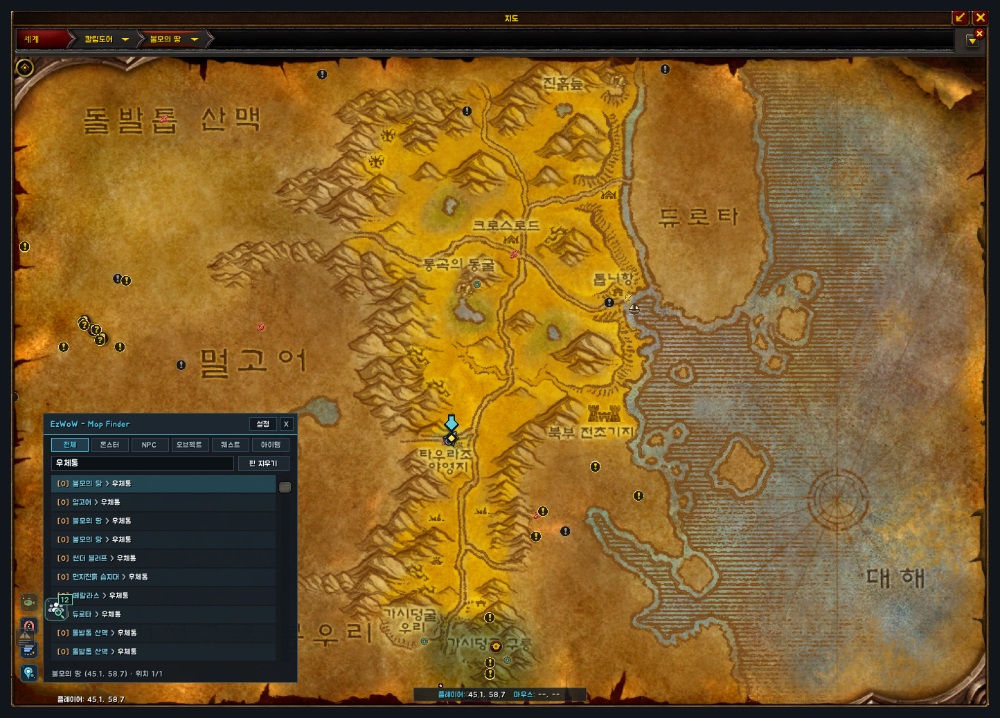
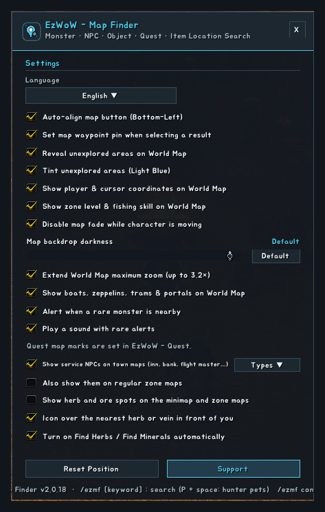
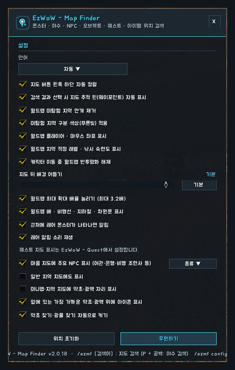

<!--
CurseForge summary (EN): Offline World Map search for monsters, rares, tameable beasts, NPCs, nodes, quests and items in 8 languages, plus map reveal, coordinates, zone levels, transport icons, rare alerts and gathering helpers.
CurseForge summary (KO): 월드맵에서 몬스터·희귀 몹·사냥꾼 야수·NPC·채집물·퀘스트·아이템 위치를 8개 언어로 검색, 안개 제거·좌표·지역 레벨·이동 수단 표시, 레어 알림, 채집 도우미.
-->

# EzWoW - Map Finder

**English** · [한국어](#한국어)

An offline location search for the World Map of WoW Forever: monsters, rare elites, tameable beasts, NPCs, gathering nodes and objects, quests and items, by name in 8 languages. It also adds World Map conveniences, an alert when a rare monster is nearby, service NPC icons on city maps and gathering helpers for herbalists and miners. Search and map jumps work in combat too.

*Mock-ups rebuilt from the window sizes, coordinates, colours and strings in the addon code and the bundled data. The map is a simplified drawing; quests and NPC names are made up.*

## Features

### Search
- Open the panel from the first dock button at the bottom-left of the World Map, or type `/ezmf keyword`.
- Category tabs: All / Monster / NPC / Object / Quest / Item.
- Prefix + space narrows the type: `M` monster, `R` rare, `P` tameable beast, `N` NPC, `O` object, `Q` quest, `I` item.
- Tameable beasts show family, level, attack speed and skills; the tooltip adds diet and stat modifiers.
- Gathering nodes show the skill they need.
- Click a result to open its zone with a bouncing arrow and a waypoint. Results are sorted current zone → nearest → the rest; each click moves to the next spawn.
- Works in combat too: the panel, `/ezmf keyword` and the rare alert's "Show on map" open the World Map and move to the zone. A transport icon clicked in combat opens its destination after combat.

### World Map conveniences
- Reveal unexplored areas, with an optional light-blue tint (battlefield map too).
- Player and cursor coordinates below the map.
- Level range (coloured against your level) and the fishing skill needed under the zone name.
- No map fade while moving, map backdrop darkness slider (0–100%, or the game's default), extended maximum zoom (up to 3.2×, off by default).
- Boats, zeppelins, the Deeprun Tram and portals in faction colours; click one to open the destination map.

### Rare alert
- A card and a sound when a rare monster is nearby (nameplate, mouseover or target). "Show on map" marks it. Once per 5 minutes per monster, not in dungeons or raids.

### Quest marks
- Turn-in spots of finished quests (a yellow `?` in a gold rim; grey `?` for quests in progress, optional).
- Objective spots of quests in progress, one dot colour per quest, on the World Map and the minimap.

### Town NPCs
- Small icons for innkeepers, bankers, auctioneers, flight and stable masters, class and profession trainers (class crests and profession icons), repair, general goods, food, reagent and trade supply vendors (bag icon), guild and battle masters, spirit healers and mailboxes on city maps. Hover for name and title, click for a waypoint. Pick the kinds in the settings; regular zone maps are optional.

### Gathering helpers (Herbalism / Mining)
- Herb and ore spots on zone maps and the minimap (nearby): green rim for herbs, orange rim for ore, dimmed when your skill is too low. Hover for the name and the skill needed. A spot is where a node can grow, not always one that is there now.
- The game's own interact icon over the nearest herb, vein or chest in front of you; your own settings come back when turned off.
- Find Herbs / Find Minerals switched on at login and after you come back to life.
- Each helper can be turned off in the settings.

## Working with EzWoW - Quest
- The quest marks are also part of **EzWoW - Quest**. While it is enabled, the quest marks here turn themselves off and EzWoW - Quest draws them; the settings window shows one note line instead of the quest options.
- EzWoW - Quest uses the location data of this addon for its map marks, so keep both enabled.
- Search, the map conveniences, rare alerts, town NPCs and the gathering helpers always stay in this addon.

## Gamepad
- With the gamepad UI on, EzWoW windows work with a gamepad: D-pad to move, A (✕) to press, X (□) for right-click, LB/RB to scroll, B (○) to close. A key guide in your pad's button style shows under the window.
- With no game window open, press **View (Back) / Create** to move to the EzWoW frames on screen. Press it again or B to go back.
- On the World Map, View / Create moves to the EzWoW icons at the bottom left.
- To use another button: Key Bindings > AddOns > EzWoW > "Gamepad: move to / leave the EzWoW frames" (with EzWoW-MapFinder installed).

## Record sharing
- Shared by all EzWoW addons and **on by default**: quest NPCs, rare monster sightings, item drops and gathering spots you have seen yourself are shared with other EzWoW users.
- `/ezshare on` / `off`, `/ezshare channel on` / `off`, `/ezshare status`

## Commands
- `/ezmf keyword` — open the search panel and search (`P wolf` and other prefixes work)
- `/ezmf config` — settings
- `/ezmf clear` — clear the search pins and the waypoint
- `/ezmf lang <auto|ko|en|de|fr|es|ru|cn|tw>` — change the display language
- `/ezmf help` — help

Languages: English, 한국어, Deutsch, Français, Español, Русский, 简体中文, 繁體中文.

---

## 한국어

WoW Forever 월드맵에서 몬스터 · 희귀 몹 · 사냥꾼이 길들일 수 있는 야수 · NPC · 채집물/오브젝트 · 퀘스트 · 아이템 위치를 8개 언어 이름으로 바로 찾아 주는 오프라인 검색 애드온입니다. 월드맵 편의 기능, 근처 레어 몬스터 알림, 도시 지도의 주요 NPC 아이콘, 약초채집·채광 캐릭터를 위한 채집 도우미도 들어 있습니다. 검색과 지도 이동은 전투 중에도 됩니다.

*애드온 코드의 창 크기·좌표·색상·문구와 내장 데이터로 재현한 예시 화면입니다. 지도는 단순화한 그림이고, 퀘스트·NPC 이름은 지어낸 예시입니다.*

## 기능

### 검색
- 월드맵 왼쪽 아래 첫 번째 도킹 버튼을 누르거나 `/ezmf 검색어`를 입력합니다.
- 분류 탭: 전체 / 몬스터 / NPC / 오브젝트 / 퀘스트 / 아이템.
- 접두어 + 공백으로 종류를 좁힙니다: `M` 몬스터, `R` 희귀, `P` 사냥꾼 야수, `N` NPC, `O` 오브젝트, `Q` 퀘스트, `I` 아이템. “오그경매”처럼 붙여 쓴 약칭도 알아듣습니다.
- 사냥꾼 야수는 야수 과 · 레벨 · 공격 속도 · 기술을, 툴팁에서 먹이와 배율까지 보여 줍니다.
- 채집물은 필요한 숙련도를 함께 표시합니다.
- 결과를 누르면 그 지역 지도로 이동해 튀는 화살표와 웨이포인트를 찍습니다. 지금 있는 지역 → 가까운 순 → 나머지 순서로 정렬되고, 누를 때마다 다음 출현 위치로 넘어갑니다.
- 전투 중에도 됩니다: 검색창 · `/ezmf 검색어` · 레어 알림의 “지도에서 보기”가 월드맵을 열고 그 지역으로 이동합니다. 이동 수단 아이콘은 전투 중에 누르면 전투가 끝난 뒤 도착지 지도를 엽니다.

### 월드맵 편의 기능
- 미탐험 지역 안개 제거와 푸른빛 구분(전장 지도 포함).
- 지도 아래 플레이어 · 마우스 좌표.
- 지역 이름 아래에 적정 레벨(내 레벨 대비 색)과 필요한 낚시 숙련도.
- 이동 중 지도 흐려짐 끄기, 지도 뒤 배경 어둡기 막대(0~100% 또는 게임 기본), 최대 확대 배율 늘리기(최대 3.2배, 처음엔 꺼짐).
- 배 · 비행선 · 깊은굴 지하철 · 차원문을 진영 색 아이콘으로 표시하고, 누르면 도착지 지도를 엽니다.

### 레어 알림
- 근처에 레어 몬스터가 보이면(이름표 · 마우스오버 · 대상) 카드와 소리로 알려 주고, “지도에서 보기”로 위치를 찍습니다. 같은 몬스터는 5분에 한 번, 던전 · 공격대에서는 알리지 않습니다.

### 퀘스트 표시
- 목표를 다 채운 퀘스트의 보고 위치(금색 테두리 안의 노란 `?`, 옵션을 켜면 진행 중인 퀘스트는 회색 `?`).
- 진행 중인 퀘스트의 목표 위치를 퀘스트마다 다른 색 점으로 월드맵과 미니맵에 표시.

### 마을 NPC 표시
- 도시 지도에 여관주인·은행원·경매인·비행 조련사·야수 관리인·직업/전문기술 교관(직업 문장·전문기술 아이콘)·수리·잡화·음식·마법 재료·직업용품 상인(가방 아이콘)·길드·전장 관리인·영혼의 치유사·우체통을 작은 아이콘으로 표시합니다. 가리키면 이름과 칭호, 누르면 웨이포인트. 설정에서 종류를 고르고, 일반 지역 지도 표시는 선택입니다.

### 채집 도우미 (약초채집 · 채광)
- 약초 · 광맥이 자랄 수 있는 자리를 지역 지도와 미니맵(가까운 곳)에 표시합니다. 약초는 초록, 광맥은 주황 테두리이고 숙련도가 모자라면 흐리게 나옵니다. 가리키면 이름과 필요 숙련도. 자랄 수 있는 자리일 뿐 항상 있지는 않습니다.
- 앞에 있는 가장 가까운 약초 · 광맥 · 상자 위에 게임 기본 상호작용 아이콘을 띄웁니다. 끄면 원래 설정으로 돌아갑니다.
- 접속할 때와 부활한 뒤에 약초 찾기 · 광물 찾기를 자동으로 켭니다.
- 설정에서 하나씩 끌 수 있습니다.

## EzWoW - Quest와 함께 쓰기
- 퀘스트 표시는 **EzWoW - Quest**에도 들어 있습니다. EzWoW - Quest가 켜져 있으면 이 애드온의 퀘스트 표시는 저절로 꺼지고 EzWoW - Quest가 그립니다. 설정창에는 퀘스트 옵션 대신 안내 한 줄이 나옵니다.
- EzWoW - Quest는 지도 표시에 이 애드온의 위치 정보를 쓰므로 두 애드온을 함께 켜 둡니다.
- 검색 · 월드맵 편의 기능 · 레어 알림 · 마을 NPC 표시 · 채집 도우미는 언제나 이 애드온이 맡습니다.

## 게임패드
- 게임패드 UI를 켜면 EzWoW 창을 패드로 다룰 수 있습니다. 방향키로 이동, A(✕)로 누르기, X(□)로 오른쪽 클릭, LB/RB로 스크롤, B(○)로 닫기입니다. 창 아래에 연결된 패드 모양으로 키 안내가 나옵니다.
- 블리자드 창이 열려 있지 않을 때 **보기(Back) / Create 버튼**을 누르면 화면의 EzWoW 프레임으로 이동합니다. 다시 누르거나 B를 누르면 돌아갑니다.
- 세계지도에서는 보기 / Create 버튼으로 왼쪽 아래 EzWoW 아이콘에 갑니다.
- 다른 버튼을 쓰려면: 설정 > 단축키 > 애드온 > EzWoW > "게임패드: EzWoW 창으로 이동/돌아가기" (EzWoW-MapFinder 설치 시)

## 기록 공유
- 모든 EzWoW 애드온이 함께 쓰며 **기본으로 켜져 있습니다**. 직접 확인한 퀘스트 NPC, 희귀 몬스터 목격, 아이템 드롭, 채집 위치를 다른 EzWoW 사용자와 나눕니다.
- `/ezshare on` / `off` (또는 `/공유`), `/ezshare channel on` / `off`, `/ezshare status`

## 명령어
- `/ezmf 검색어` — 검색창을 열고 바로 검색 (`P 늑대`처럼 접두어 사용 가능)
- `/ezmf config` (`설정`) — 설정창
- `/ezmf clear` — 지도에 찍은 검색 핀과 웨이포인트 지우기
- `/ezmf lang <auto|ko|en|de|fr|es|ru|cn|tw>` — 표시 언어 변경
- `/ezmf help` — 도움말

지원 언어: English, 한국어, Deutsch, Français, Español, Русский, 简体中文, 繁體中文.
